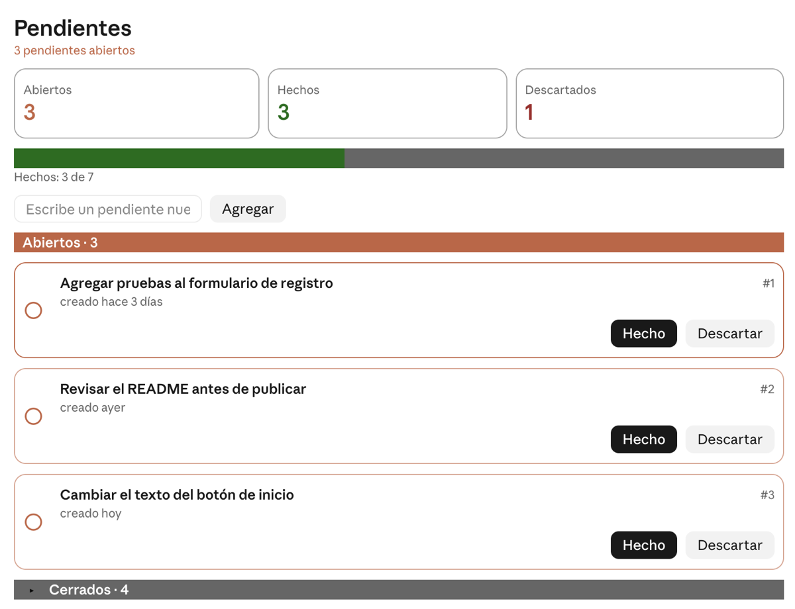
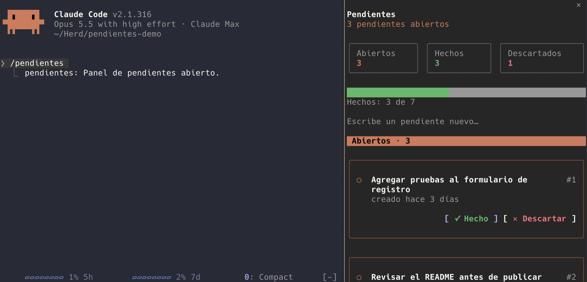

<div align="center">


# Pendientes

**Lo que queda por hacer en cada proyecto, en una lista que no se pierde entre chats.**

Un mod para Claude Code que guarda los pendientes de cada proyecto en un archivo, los muestra en un panel con botones y le recuerda a Claude qué sigue abierto cada vez que empiezas una conversación.


</div>

---

## Así se ve

En la app de escritorio:



En la terminal:



## Por qué

En una conversación larga van saliendo tareas que no se resuelven ese día: "luego revisamos el README", "falta el ícono". Cuando cierras el chat, esas tareas se pierden. Pendientes las guarda en tu proyecto, te las muestra en un panel y Claude las ve en cada conversación nueva.

## Instalación

En la terminal, dentro de Claude Code:

```
/plugin install pendientes --marketplace gereyes/pendientes
```

Responde `y` para agregar el marketplace y elige el alcance con Enter. El mod queda activo de inmediato.

Desde la línea de comandos:

```
claude plugin install pendientes --marketplace gereyes/pendientes
```

En la app de escritorio, en la pestaña **Code**: haz clic en **+** junto al cuadro de texto, luego **Plugins**, **Add marketplace** con `gereyes/pendientes` y después **Add plugin**.

## Ejemplos

| Le dices a Claude | Qué pasa |
|---|---|
| Agrega como pendiente revisar el README | Queda en la lista como pendiente abierto, con la fecha de hoy. |
| Ya quedó el README, ciérralo | Claude lo marca como hecho. El texto original no cambia. |
| Ese del ícono ya no aplica | Claude lo marca como descartado. |
| ¿Qué tengo pendiente? | Claude ya conoce la lista desde el inicio de la conversación y te responde sin buscarla. |

## El panel

Escribe `/pendientes` para abrirlo. Muestra:

- Cuántos pendientes tienes abiertos, hechos y descartados, y una barra de avance.
- Un campo para escribir un pendiente nuevo y agregarlo con **Agregar** o con Enter.
- Una tarjeta por cada pendiente abierto, con su antigüedad ("creado hoy", "hace 3 días") y los botones **Hecho** y **Descartar**. Antes de cerrar uno, el panel te pide confirmar.
- La sección **Cerrados**, oculta hasta que la abres con la flecha. Muestra los 5 más recientes, cada uno con el botón **Retomar**.

Donde la pantalla no puede mostrar paneles, `/pendientes` te responde con la lista en texto.

## Cómo funciona

- Cada proyecto tiene su propia lista en `.claude/pendientes.md`, dentro de la carpeta del proyecto.
- El archivo es una bitácora: solo se agregan pendientes o se cierran, nunca se reescribe ni se borra texto. Un pendiente cerrado se queda en la sección **Hechos** o **Descartados** con su fecha.
- **Retomar** no reabre el pendiente cerrado: agrega uno nuevo con el mismo texto, para que el historial siga intacto. Si ya hay uno abierto igual, no lo duplica.
- Claude cambia la lista solo con dos herramientas del mod, `agregar` y `cerrar`. Si intenta editar el archivo directamente, o escribir en él desde la terminal, el mod lo bloquea. Leerlo sí está permitido.
- Al inicio de cada conversación, Claude recibe la lista de pendientes abiertos y la instrucción de registrar ahí las tareas que no se resuelvan en ese turno.

Así se ve el archivo:

```markdown
## Pendientes

- [ ] Revisar el README — creado 2026-11-02

## Hechos

- [x] Agregar el panel — creado 2026-10-31, hecho 2026-11-01

## Descartados

- [-] Cambiar el color del título — creado 2026-10-31, descartado 2026-11-01
```

## Comando

- `/pendientes`: abre el panel de pendientes del proyecto.

## Qué datos maneja

- El mod no se conecta a internet ni llama a ningún modelo.
- Solo escribe en `.claude/pendientes.md`, dentro de la carpeta del proyecto en el que trabajas.
- La lista de pendientes abiertos se agrega a lo que Claude lee al empezar cada conversación, igual que cualquier otro texto de tu sesión.
- Si tu proyecto usa git, `.claude/pendientes.md` puede subirse con el resto. Si no quieres compartirlo, agrégalo a tu `.gitignore`.

## Solución de problemas

- **No aparece el comando `/pendientes`.** Revisa que estés en la terminal o en la pestaña **Code** de la app de escritorio; la pestaña Chat no carga mods. Si la sesión ya estaba abierta cuando lo instalaste, escribe `/reload-plugins` o abre una nueva.
- **No veo los pendientes de otro proyecto.** Cada carpeta tiene su propia lista. En la app de escritorio, una conversación sin carpeta elegida guarda su lista en una carpeta temporal.
- **Claude dice que no puede editar `pendientes.md`.** Es a propósito: la lista solo cambia con las herramientas del mod, así el historial no se reescribe.
- **El campo para agregar no ocupa todo el ancho en la app de escritorio.** La app dibuja ese campo con un ancho fijo; el mod no lo puede cambiar.

## Requisitos

Claude Code 2.1.287 o más nuevo en la terminal, o 2.1.286 o más nuevo en la pestaña Code de la app de escritorio.

## Licencia

[MIT](LICENSE)

---

<sub>**English:** Pendientes ("to-dos") is a Claude Code mod that keeps a per-project to-do list in `.claude/pendientes.md`, an append-only log Claude changes only through the mod's `agregar` and `cerrar` tools. `/pendientes` opens a pane to add, close, confirm and reopen items. It makes no network or model calls.</sub>
